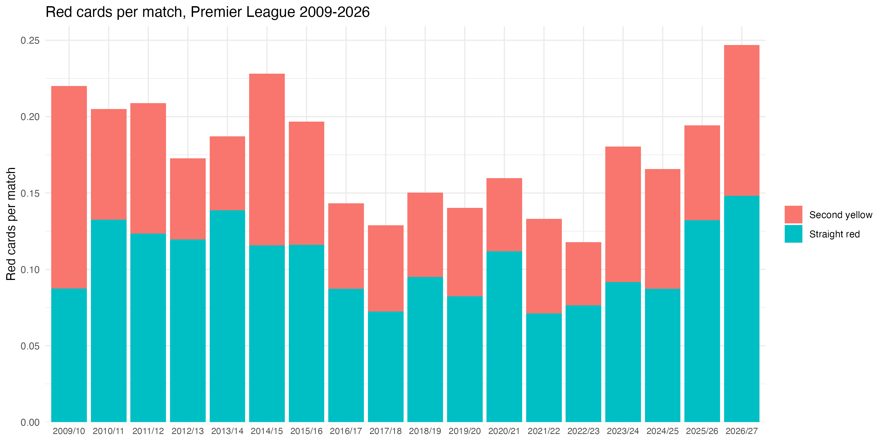
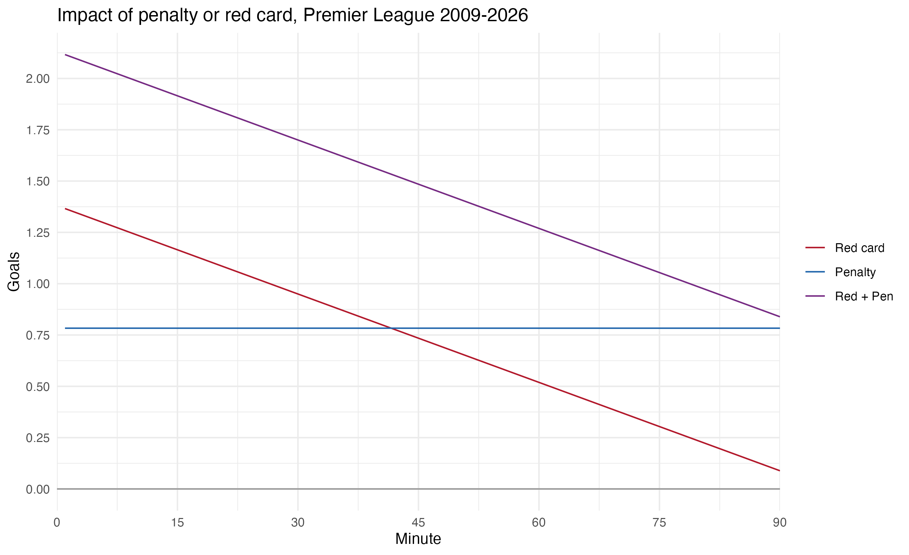

::: {.centered-block}

<em>Manchester United's Nemanja Vidic sees red against Liverpool (Wikimedia Commons)</em>
:::

It seems like controversial red cards have been a talking point in almost every weekend of the 2026/27 Premier League season. Phil Foden versus Manchester United. Ryan Gravenberch versus Manchester City. Igor Thiago versus Brighton. Lenny Yoro versus Liverpool. These decisions provoke so much discussion because red cards can be so incredibly punitive -- I think the current red card system is too harsh, and needs to be rethought.

Firstly, it seems like there have been a lot of red cards this season. Is that correct?

::: {.centered-block}

:::

Indeed, 2026/27 currently has the highest number of red cards per match since at least 2009/10, although this follows a period of reduced dismissals since 2016.

# Red cards, penalties, and time elapsed

The two ways a referee can have a huge influence on a football match are by awarding (i) a red card or (ii) a penalty. There is a key distinction between these two incidents: penalties have essentially the same value at any point in the match, whereas the impact of a red card massively depends on when it happens.

To demonstrate this, I fit a linear regression using Premier League matches since 2009 to predict the change in the final score based on a red card or penalty, taking into account the pre-match odds, game state and time elapsed. While the effects vary slightly based on the strengths of the teams and the current score, below is the simplest example: the median team with the scores level at the time of the incident.

::: {.centered-block}

:::

A red card in the first minute of a match would be worth around **1.38 goals**, while a red card entering second-half injury time would only be worth around **0.1 goals**. Meanwhile, a penalty kick is consistently valued around **0.78 goals** no matter when it occurs.

This is something most people intuitively understand, of course, without needing to run a regression model. But do we ever stop to think whether this is an appropriate approach to punishments? If you get fouled in the box, it is a penalty. One penalty kick. You would not say "well it's early in the game, so have two penalty kicks." Why should red card offences be different?

It also creates an asymmetry where a defender, if he is quick enough to do the mathematics in his head, may decide it is worth hauling down an attacker to prevent a goal if it's late in the game, but not if it's early in the game. That doesn't feel right.

# It gets worse: double jeopardy & suspensions

The harshest punishment of all is the so-called "double jeopardy" where a player concedes a penalty AND is shown a red card for denying a goalscoring opportunity. These were largely removed from the game a few years ago but there remains a clause that the defender can still be sent off after conceding a penalty if it is deemed he was not going for the ball.

An example of this was Tottenham's Micky Van de Ven in a crucial match against Crystal Palace last season. With Spurs leading 1-0, Van de Ven pulled back Ismaila Sarr as he raced through on goal in the 38th minute. The resulting penalty & red card combined were worth about **1.6 goals**. Ironically, if Van de Ven had absolutely scythed the attacker down instead of giving his shirt a little tug, he probably would have avoided the red card because he would be deemed to have been going for the ball.

A punishment of 1.6 goals is enormous in a sport where the average is less than 3 goals per game. Think of an equivalent in other sports -- it would be like an NFL team being penalized by three touchdowns. 

And as if this wasn't enough, the player also incurs a suspension! As well as heaping on even more punishment, this has the knock-on effect of randomly benefitting some other team that happens to be next up on the fixture list. Is this really necessary? In my view, suspending a professional from his job should be extremely serious in any walk of life. It should be as a result of disgraceful conduct, not a mistimed tackle in the normal course of play. 

# Counterarguments and possible solutions

The main counterargument is that the punishment for red card offences *should* be harsh, so it acts as a deterrent. But I think the current proliferation of red cards each week is evidence that the deterrent is not working. Footballers know the rules but they are still human: they instinctively put their hand on a player to hinder his progress towards goal, they lunge in for loose balls, and they sometimes petulantly flick out their leg when tumbling on the floor with an opponent.

And players absolutely know how valuable it is to play against 10 men, so they will cheat and dive and roll around on the floor to try and get opponents sent off. One of the unforeseen effects of VAR is it has actually *increased* the amount of playacting in football -- previously they were just trying to con the on-field referee, but now they have to make a big deal of going to ground to signal to the VAR that he needs to review the incident. 

The question is, if red cards aren't working, what do we replace them with? Here are a few ideas:

- A foul outside the penalty area where the forward was clean through on goal could just be a penalty.
- The double-jeopardy rule should be extended to all fouls, with no exception for "not going for the ball".
- A fixed-time sin bin would reduce the impact of early red cards.
- A player sent off for "violent conduct" (it's hard to take that term seriously when you watch the actual red card offences) could be replaced by a substitute, as happens in most sports.
- Remove suspensions, except for the most serious offences (genuine violent conduct) or repeat offenders.

# Closing thoughts

The fundamental goal of any sporting contest is to see which team is best. When you give one of the teams a significant handicap, that concept becomes meaningless. Would Liverpool have beaten Manchester United last week if it was 11 v 11? We have no idea. If Yoro's foul on Isak had been a penalty instead of a red card, at least you would get to see the rest of the game play out, whatever you thought about the foul itself.

So it's time to overhaul the red card & suspension system. Instead of slaughtering the refs every weekend, let's give them a more flexible set of rules so that they aren't faced with a binary choice for each incident of "almost no punishment" versus "this will probably decide the entire match". We have inherited these conventions from a totally different era, and there is no need to be wedded to it.



© 2026 John Knight. All rights reserved.